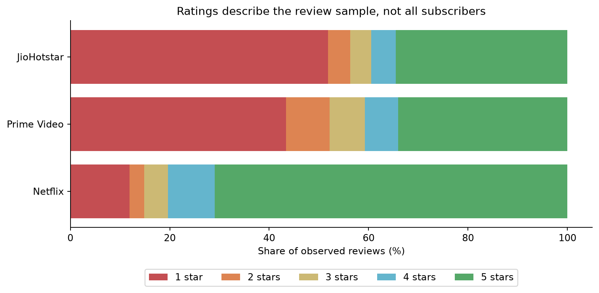
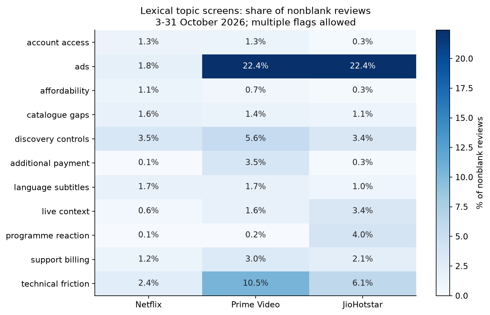
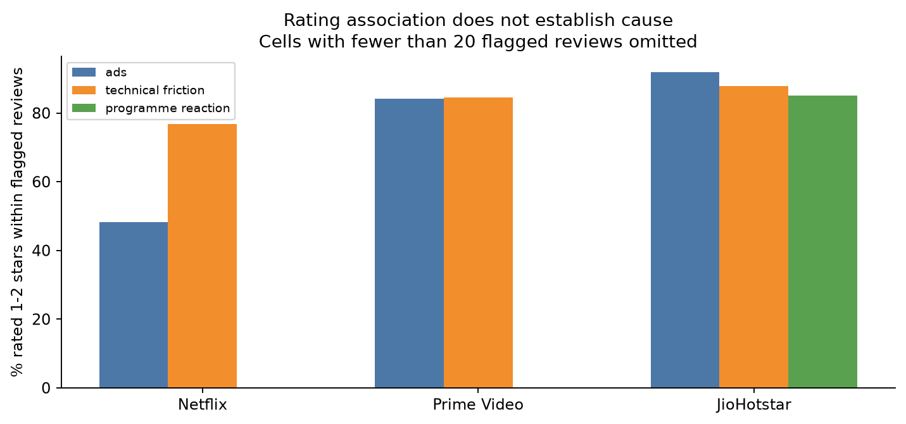
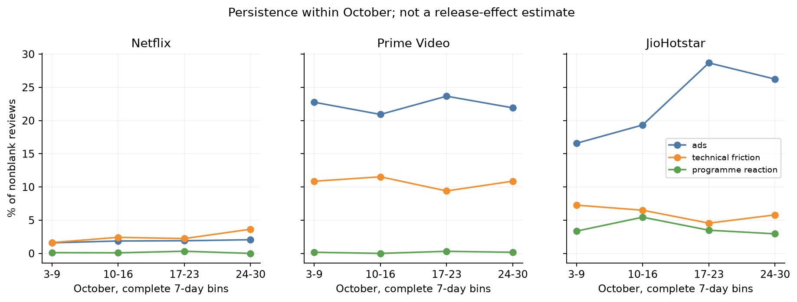
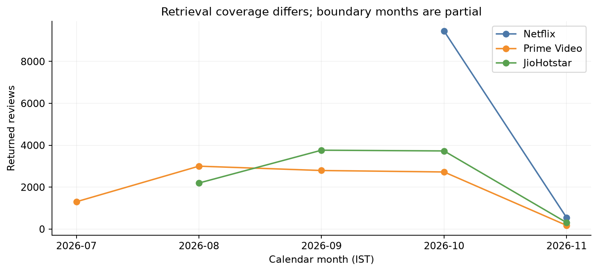
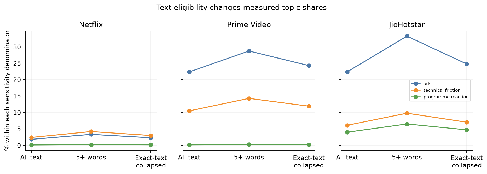

# What gets in the way of watching? An OTT review analysis

**Decision:** Which viewing problem should a streaming product team investigate first?

**Recommendation:** For Prime Video and JioHotstar, investigate when viewers encounter ads relative to what they expect their plan to include. Separate that question from a second, narrower engineering question: whether playback reliably resumes after an ad, seek, or background transition. For Netflix, prioritise diagnosis of reported playback and account-access blocks rather than extrapolating the ad finding across products.

## Evidence base

The source is a 30,000-record Google Play export: 10,000 unique reviews per app, no scraper error rows or duplicate app-review IDs. The apps reach different historical dates. All cross-app results below use the same **3–31 October 2026** calendar window (India time), containing **15,289 reviews**. Topic denominators exclude the one blank review. The full export is used only for within-app historical context. Neither the scraper's retrieval settings nor the review text verifies a reviewer's residence.

| App | Shared-window reviews | Mean stars | 1–2 stars | Text of 1–3 words | Version missing |
| --- | ---: | ---: | ---: | ---: | ---: |
| Netflix | 9,244 | 4.25 | 14.8% | 3,912 | 1,687 |
| Prime Video | 2,530 | 2.79 | 52.1% | 749 | 312 |
| JioHotstar | 3,515 | 2.66 | 56.3% | 1,396 | 1,077 |

These are distributions of returned reviews, not app-wide ratings, user satisfaction rates, or a rank of product quality. [Collection coverage](../expansion_coverage.md) and [field audit](../expansion_quality.md) document the source and exclusions.

## 1. What tasks, expectations, positives, and problems appear?

Reading the pilot and a stratified development sample surfaced the journey from finding a title, through confirming what is included, to starting and controlling playback. The clearest problems in the text include repeated ad interruptions, unexpected extra payment, titles or episodes unavailable, playback stalling, subtitle/audio options, and account or device access. Some reviews concern a programme's storyline or elimination decisions rather than the app's functioning.

Positive examples include appreciation of catalogue variety, family-friendly content, playback quality, and use across devices. Much praise is generic. The reading also surfaced mixed reviews: a viewer may enjoy the catalogue while objecting to ads or price. For example, a [Prime Video review](https://play.google.com/store/apps/details?id=com.amazon.avod.thirdpartyclient&reviewId=359e7c03-292b-4b39-8e69-4f6c819c531e) praises movies while objecting to ads after paying; a [Netflix review](https://play.google.com/store/apps/details?id=com.netflix.mediaclient&reviewId=9785ade9-360e-4176-be89-8e658263c143) praises the absence of ads and the content. This is why a mention of “ads” cannot automatically be coded as a complaint. No full-dataset positive-theme rates are estimated.

## 2. How do themes and ratings vary by app?

This table reports **keyword flags per nonblank review**, with multiple flags allowed. Some categories are broad. For instance, “discovery and controls” includes positive mentions and feature requests; a “technical friction” flag may also be a policy-related inability to watch. These are screening counts to guide investigation.

| Flag | Netflix (9,243) | Prime Video (2,530) | JioHotstar (3,515) |
| --- | ---: | ---: | ---: |
| Ads | 170 (1.8%) | 566 (22.4%) | 787 (22.4%) |
| Technical friction | 224 (2.4%) | 266 (10.5%) | 215 (6.1%) |
| Discovery and controls | 323 (3.5%) | 141 (5.6%) | 118 (3.4%) |
| Additional payment / rental language | 10 (0.1%) | 89 (3.5%) | 11 (0.3%) |
| Catalogue gaps | 147 (1.6%) | 36 (1.4%) | 38 (1.1%) |
| Account access | 116 (1.3%) | 34 (1.3%) | 11 (0.3%) |
| Programme reaction | 12 (0.1%) | 4 (0.2%) | 141 (4.0%) |

A less common problem can still have a strong association with low ratings. On Netflix, **172/224 (76.8%)** technical-flagged reviews rated 1–2 stars versus **13.3%** without the flag. For ad mentions, the equivalents are **476/566 (84.1%) vs 42.9%** on Prime Video and **723/787 (91.9%) vs 46.0%** on JioHotstar. The 4–5-star group still contains **37** Prime Video and **34** JioHotstar ad mentions; reading text is necessary to distinguish complaints from praise.

To check whether the very different rating mixes explain the ad pattern arithmetically, I reweighted each app's within-star mention rates using the same pooled star distribution. Ad shares change to **2.6% Netflix, 14.6% Prime Video, and 13.6% JioHotstar**. The difference narrows but remains. For technical flags, the adjusted values are **4.4%, 6.7%, and 4.1%**: the Netflix–JioHotstar ordering reverses. This is a descriptive sensitivity check, not a causal adjustment: rating is itself related to experience and who reviews remains unknown.

## 3. Which patterns recur, and which look more concentrated?

Four complete seven-day bins cover 3–30 October. The 31st remains in the overall October comparison but is excluded from this weekly chart.

- **Prime Video:** ad mentions are present in all four weeks, between **20.9% and 23.7%**. Technical-friction flags are also recurrent, between **9.4% and 11.5%**. In its longer snapshot, ad shares are **19.9% in August, 24.4% in September, and 21.9% in October**. This supports persistence in the observed records, subject to retrieval completeness.
- **JioHotstar:** ad mentions appear throughout, from **16.6%** in the first week to a **28.7%** peak in 17–23 October, then **26.2%** in 24–30 October. September and October within-app shares are **17.8% and 22.3%**. August starts on the 9th and is not a complete month. Programme discussion also appears across weeks but clusters on some days: **20/161** reviews on 31 October carry the programme flag, accounting for **14.2%** of its 141 flagged reviews in the comparison window. This is a concentration in review text, not evidence of an outage or proof of a specific triggering event.
- **Netflix:** technical flags rise from **42/2,576 (1.6%)** in 3–9 October to **69/1,895 (3.6%)** in 24–30 October. This is a concrete candidate for follow-up. The data cannot tell whether it reflects a release, device mix, changed review composition, or another event.

No app reaches the planned May start. Netflix only reaches 2 October, Prime Video 19 July, and JioHotstar 9 August. No six-month cross-app trend is claimed. Version is missing in **6,107/30,000 (20.4%)** records. An app version in a review is not a rollout date, and neither review timestamps nor version text establish a release effect.

## 4. How do content, price, live viewing, and usability differ?

| Context | What the reviews show | How to interpret it |
| --- | --- | --- |
| **Price and entitlement** | Ads and payment/membership words co-occur in **203/2,530** Prime Video and **183/3,515** JioHotstar reviews. Prime Video reviewers also describe encountering rental results while searching with a subscription. | These are clues about expectations. A co-occurrence does not verify paid status, plan, an unexpected charge, or a breach of terms. |
| **Playback and navigation** | Ads and seeking/resume words co-occur in **23** Prime Video and **5** JioHotstar reviews. Some reviewers describe repeat ads while rewinding; others describe playback not resuming after an ad. | These are narrower candidate mechanisms, not the majority of ad mentions. Check ad scheduling and resume telemetry separately. |
| **Live and programme context** | JioHotstar has **118** live/sports-context flags and **141** programme-reaction flags; [one show reaction](https://play.google.com/store/apps/details?id=in.startv.hotstar&reviewId=b56f2b55-c038-4965-8348-7eb0a8671cfa) asks others to rate the app over a perceived show outcome. | Live/sports terms are only context clues. Untagged reviews cannot be assumed to describe on-demand sessions. Programme reactions are valid feedback about content, but should be separated from technical triage. |
| **Access and device switching** | Netflix reviewers describe household/device verification and difficulty resuming across TVs. JioHotstar examples mention OTP and TV activation friction. | Separate documented restrictions, activation clarity, and faults; the export cannot verify eligibility or device configuration. |

Official product context helps frame the alternatives. [Prime Video's Ad Free help](https://www.primevideo.com/help?nodeId=TR7P4YDu3J97ETYJ7S) describes a separate ad-free offering, and its [terms](https://digprjsurvey.amazon.com/csad/help/node/G202095490) distinguish subscription content from rental/purchase. [JioHotstar's published plan announcement](https://cdn.jiostar.com/jiostar/wp-content/uploads/2026/01/JioHotstar-Introduces-Monthly-Plans.pdf) identifies live programming exceptions to ad-free entertainment. [Netflix's household help](https://help.netflix.com/en/node/127200) documents an access and recovery flow. These documents describe product distinctions; they cannot identify the plan or market applicable to an individual October review.

## 5. Which candidate problems should be prioritised, and what could explain them instead?

**First: ad expectations and interruption during viewing.** Prime Video and JioHotstar ad mentions recur across all observed weeks and remain prominent under the same star mix. Two [review](https://play.google.com/store/apps/details?id=com.amazon.avod.thirdpartyclient&reviewId=28ecf04b-be44-4767-a6ec-f72de9919e89) [examples](https://play.google.com/store/apps/details?id=in.startv.hotstar&reviewId=f99d00d8-3f7b-4a3d-b48e-d5ea9f4c8b76) describe repeat ads after seeking or a video failing to resume after an ad. Possible explanations include expected ad-supported plans, live exceptions, too-frequent breaks, unclear disclosure, and actual player faults. Audit the upgrade and pre-play messaging for the first two; instrument repeated ad pods after a seek and successful post-ad resumes for the latter. Track support contacts or repeated ad pods alongside ad revenue per viewing hour as proposed evaluation measures; none is observable here.

**Second: playback/access blocks.** The technical and explicit-blockage screens co-occur in **90** Netflix, **84** Prime Video, and **47** JioHotstar records. The [Netflix loading example](https://play.google.com/store/apps/details?id=com.netflix.mediaclient&reviewId=0e3fd6c8-8121-4327-9cf0-19e08f79d23f) and [Prime Video device example](https://play.google.com/store/apps/details?id=com.amazon.avod.thirdpartyclient&reviewId=25ad4e80-6b0b-41ba-be53-ca928a4341c9) make the interrupted task clear. Count co-occurrences as review signals, not confirmed incidents. Separate playback-start failure, app launch, access policy, and network/device conditions before assigning engineering ownership.

**Third: clarity about included titles.** Prime Video's extra-payment flag appears in **89/2,530 (3.5%)** reviews; **54** also mention payment or membership context. [One reviewer](https://play.google.com/store/apps/details?id=com.amazon.avod.thirdpartyclient&reviewId=e20eff35-c8a1-44cd-88bd-b55644a402ea) explicitly requests separating included and paid titles. This merits an entitlement-label/search-filter audit, not a conclusion that rentals themselves are a defect. The flag also catches some ad-free upgrade language, so 89 is not an exact rental-complaint count.

**Problem statement:** When attempting to watch or resume a title, some Prime Video and JioHotstar reviewers report interruptions they did not expect from their subscription or difficulty continuing after an ad. The available evidence supports investigating expectation-setting and player behaviour separately. It does not identify the affected share of subscribers, establish actual plan violations, or quantify churn.

## Robustness, measurement limits, and reproducibility

- **Text selection changes the magnitude.** Keeping only reviews of at least five words changes ad mentions from 22.4% to **28.8%** on Prime Video and **33.3%** on JioHotstar. Collapsing exact repeated text gives **24.3%** and **24.8%**. Neither test estimates population prevalence; short comments can be meaningful and repeat wording is not evidence of fraud.
- **Programme reactions do not explain away the ad signal.** Excluding flagged programme reactions leaves ad shares of **22.4%** and **23.1%** in the two apps. For JioHotstar, 1–2-star share moves from **56.3% to 55.1%**. Keep the content dimension in product reporting while routing it separately.
- **Language remains a blind spot.** The English-heavy rules include some Romanised Hindi and preserve all text. There is no validated language classifier or representative Hindi corpus. Removing detected non-Latin script does not identify an English-only sample; it is only a sensitivity check.
- **Coding is transparent and imperfect.** I read 100 stratified development cases and checked 20 separate cases, one requiring translation. The 19 evaluable cases included only three ad positives (all found) and four technical positives (two found). Catalogue and programme ambiguity led to rule revisions. The same diagnostic cases are not independent validation of the revised rules. Low-recall themes, negation, short phrases and mixed languages can affect counts. Unflagged is not “no problem.” An audited substantive-only denominator and precise complaint mix remain future work, so this report uses all nonblank reviews.
- **Replies aren't resolution.** 327 shared-window reviews have returned replies, all JioHotstar. The full snapshot has 70 replies dated before the associated review timestamp, possibly because of edits or source behaviour. No fair response-time ranking is supported.

**Reproduce:** Install the packages in [requirements-analysis.txt](../../requirements-analysis.txt), then run `python analysis/run_analysis.py` from the project. It writes the JSON tables, charts, audit cases, and `ott_analysis.sqlite`. Run [portfolio SQL queries](../../analysis/portfolio_queries.sql) against that database to inspect counts, comparisons and sensitivity results. The source files and hash are documented in the [expanded audit](../expansion_quality.md). The original review export is retained separately; analytical outputs omit reviewer names and photos.
